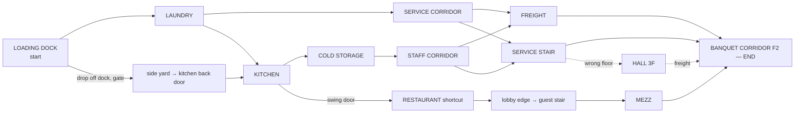

# EP01 — SCENE 07: THE SERVICE CHASE

Target: 4–6 minutes of continuous play. "Уйти умом."
The chase is a **route graph of rooms**. Each room offers 2–4 **tools**. The pursuers are simple state machines. Success comes from using tools, breaking line of sight and bluffing, not from combat.

## 1. Actors

| Actor | Speed (hero run = 1.0) | Senses | Behaviour |
|---|---|---|---|
| Hero | walk 0.35, fast 0.6, run 1.0, crouch 0.3, slide 1.2 burst | — | Stamina is **not** used. Run is unlimited, so tension comes from geometry. |
| Brody | 0.9 | sight cone 80°/12 m, hearing: run 8 m, noise objects 15 m | Never vaults (pathfinds around). Grabs at < 1.0 m. Stun on trip 2.5 s. |
| Sato | 1.05 | sight 70°/14 m, hearing as above | Vaults (0.6 s). Checks side doors (stops 1 s at each door he passes when he has lost sight). Radios the hero's last-seen position to Brody, who teleports up to one room closer, off-screen only. |
| Hotel staff (silhouettes) | — | — | During the fire alarm: crowd the corridors and give social cover. Pursuers won't grab in front of 2+ staff. |

## 2. Pursuer state machine

```
SPAWN → PURSUIT ⇄ SEARCH → (lost 12 s) → REGROUP (returns to last radio point)
PURSUIT → GRAB (in range) → STRUGGLE (1 s window)
any → STUNNED (trip/door/cart; duration per tool)
any → DOUBT (radio bluff; 2–3 s, then CALLED_BLUFF → PURSUIT +10% speed for 6 s)
any → CONTAINED (locked in freezer / behind locked door until rerouted, 20 s+)
SEARCH: walk to last known position, check 2 nearest hide/cover points, listen
```

**Rubber-band (comfort):** if the hero is > 25 m ahead and unseen, Sato is "radio-guided" toward the hero's current room (to keep tension). If a pursuer is < 3 m behind for > 4 s, he slows 10% (to prevent cheap catches).

**Heat (0–3)** drives the music layers and the pursuers' speed bonus (+0/3/6/9%). Heat increases on being seen and decreases after 10 s unseen.

## 3. Grabs and the fail-forward

- **Grab #1:** a struggle prompt (tap context ×3 within 1 s, or a timing tap on pad) means the hero shoves free and the pursuer is stunned 1.5 s. On a failed struggle the hero still breaks free, but with a 1 s stumble. **Grab #1 never ends the chase.**
- **Grab #2 → CAUGHT → INTERROGATION (fail-forward scene, 60–90 s, playable).**
  - The hero is dragged into COLD_STORAGE and pushed against the shelving. Brody holds; Sato talks: «Где она? Где запись?»
  - They pat him down. If he has Mara's 307 phone, they take it (`items.mara_phone → sato`). They take the hero's phone and Sato pockets it (it is returned by Thomas in Scene 08, so Ending D remains possible).
  - The hero still has verbs: chips (BLUFF «Запись у Адриана. Он вам не сказал?» which makes Sato radio Daniel, so Brody's attention drifts: an escape window), LIE about the location («Шестой этаж.»), PROVOKE Brody, SILENCE. Environment: a shelf of crates the hero can kick (Space when Brody looks away). Freezer door behind Sato (shove into it).
  - Every option leads to an escape within ~60 s. The worst case: on the second bad choice, Thomas returns (he heard) and slams a crate into Brody, then the chase resumes at full heat.
  - Consequences: `threat.daniel_knows_hero_met_thomas = true`, `daniel.suspicion +1` (finale: Daniel arrives warier, pressure −1 initially), phone loss (returned), and possibly the lie: if the hero said «Шестой этаж», Daniel's men are on F6 later (the finale thugs come late, which is a tiny benefit).
- There is **no** death, knockout, or checkpoint reload.

## 4. Route graph



**Viable routes** (each 3–5 min with typical play):

| Route | Path | Signature beats |
|---|---|---|
| A "Kitchen run" | Dock → Laundry → Kitchen → Cold → Staff → Service Stair → F2 | Freezer lock-in, breaker blackout, stair drop |
| B "Freight" | Dock → Laundry → Service Corridor → Freight Elevator → F2 | Cart wall, elevator decoy or ride standoff |
| C "Front-of-house" (risky) | Dock → Kitchen → swing door → Restaurant → Lobby → Guest Stair → Mezzanine → F2 | Pursuers can't run in public (Pavel present): a *social stealth* segment where the hero walks, and running raises Pavel's attention. Pursuers walk too and follow at a distance. |

All routes end at BANQUET_CORRIDOR_F2, where Mara pulls the hero into the Orchid Room. **End condition:** the hero enters BCORR with no pursuer within 6 m in sight, OR after 30 s in BCORR regardless (Mara intervenes: lights off, door, pull).

## 5. Room-by-room tools

### LOADING DOCK (start, 20–40 s)
- **Start:** Brody and Sato at the van, 15 m away. The hero is on the raised dock with Thomas's car in between.
- **Tools:**
  - Volvo car alarm (if he has the keys): a 4 s distraction.
  - Drop off the dock edge (a shortcut to the side yard; Brody goes around).
  - Roll-cart down the ramp (E: shove; it rolls into the pursuer lane, a 1.5 s stun if hit).
  - Laundry door (closes behind the hero; he can't lock it).
- READ during the chase works at 0.8 time scale (not 0.6). It reveals the pursuers' gaze direction (O_CH_LOOKING_AWAY) as a tell, useful for slipping.

### LAUNDRY (40–60 s)
- Folding-table slide (Ctrl while running; Brody must go around).
- Hanging sheets: running through them breaks line of sight for 1.5 s.
- Machine rows: break LOS; crouch-hide behind them (a SEARCH pursuer checks 2 nearest cover points: risky).
- Laundry cart: push it into the doorway (blocks the door for Brody for 3 s; Sato vaults it).
- Steam press: press E → a steam burst into the lane, which stuns the pursuer 1 s and reveals his position.

### KITCHEN (40–70 s)
- Prep island vault (Space).
- Pots rack: knock it over → noise at that spot (it draws SEARCH), and it blocks the lane (0.8 s slow).
- Throw a bottle (pick one from the shelf → aim → throw): a noise lure up to 15 m.
- **Fire suppression pull** (hood): foam and sprinklers in the kitchen. The pursuers' sight drops to 4 m for 10 s; everyone moves at 0.8× speed; staff alarm audio. One use.
- Swing door → restaurant (route C).
- Cold storage door.

### COLD STORAGE (30–50 s)
- **Freezer lure:** throw a bottle *into* the walk-in freezer or knock a tray in it; the pursuer goes to check it; slam and latch the door (E within 2 s). CONTAINED for 20 s, after which Sato frees Brody (or vice versa). A single pursuer locked means the other pursuer gets +5% speed (anger), plus a bark («Броди?!»).
- Shelving rows: break LOS.
- Back door → staff corridor.

### STAFF CORRIDOR (30–50 s)
- **Breaker panel:** lights out for 8 s. Pursuers SEARCH by sound only; the hero sees only silhouettes (an emergency-light glow). Walking is silent; running is heard.
- **Radio on the bench** (a dropped staff radio): pick it up, then use the bluff `C_DANIEL_SAID_STOP` («Дэниел сказал прекратить. Проверь телефон.») → DOUBT window (Brody 2 s, Sato 3 s, or CALLED). Can also be shouted without the radio at reduced odds (+1 savvy for the pursuer).
- Lockers: hide once (E). The second hide in the same locker is found.
- Doors to the freight elevator and the service stair.

### SERVICE CORRIDOR (route B, 20–40 s)
- Linen carts: shove two together → a cart wall (Brody blocked 4 s; Sato vaults).
- **Fire alarm pull** (one per episode): the alarm sounds and 3–6 staff silhouettes spill out. Pursuers enter "public" mode: walk only, no grabs within 4 m of staff. The hero can blend: walking among staff = not seen if > 6 m away. Lasts 25 s.
- Metal fire door: close it (E). Lockable only with Lina's staff keycard (ALLY), giving CONTAINED for 15 s.

### FREIGHT ELEVATOR
- **Ride:** call it (it arrives in 4 s if not present, during which the hero must hold position), enter, press F2. The doors take 2 s to close: a tense beat. If a pursuer reaches the door gap he blocks it, and a struggle prompt follows (the shove counts as grab #1 logic).
- **Decoy:** send it empty to F3 (E on the outside panel). Sato radios «Он в лифте» and they run the stairs. The hero then takes the service stair *down/up* the other way or waits for the elevator to return.

### SERVICE STAIR (30–60 s)
- Vertical section camera. Up toward F2.
- Landing drop: from landing 3 to landing 2 between the flights (Space at the railing gap): a one-way shortcut, 0.5 s landing stun.
- The door to HALL_3F is a wrong floor (if overshot); the freight elevator there goes down to F2.
- Stairwell echo: footsteps are louder (the noise radius ×1.5), so walking gains value.

### BANQUET CORRIDOR F2 / BANQUET HALL (end, 20–40 s)
- Table vault chain in the banquet hall (Brody goes around: a big gain).
- Tablecloth hide (crouch under a clothed table; a SEARCH pursuer lifts one random cloth: 1/3 risk).
- The Orchid Room door at the far end. Mara's intervention (CINE ≤ 8 s): the corridor lights go out (she pulled the breaker), the door opens, a hand grabs the collar and pulls. The pursuers pass; muffled radio: «Потеряли. Проверь крышу.»

## 6. Light melee (allowed, limited)

- **Shove** (context when a pursuer is within 1.2 m, facing): 1 s stun. Cooldown 4 s.
- **Improvised hit** (a bottle or tray held, then context): 2 s stun; the item breaks.
- No combos, health bars or knockouts. Hitting Brody twice makes him angry (+5% speed).

## 7. Camera & readability

- Each room has a chase rig with a **lead offset** in the run direction (30% screen) and a minimum frame that keeps the closest pursuer on screen or at the edge with an indicator (a small red chevron at the screen edge plus a footstep audio pan).
- Room transitions use the door-wipe (0.25 s). The pursuer arrival delay after a transition = his distance at the moment of transition ÷ speed (computed; the pursuer spawns at the target doorway).

## 8. Audio & music

- Music states `CHASE_1..3` follow heat (drums, then strings, then high ostinato). During DOUBT the music drops to a single held note for its duration, which is a satisfying audible reward. In blackout: music filtered and heartbeat added.
- Each tool has a distinct SFX (cart rattle, freezer latch clunk, breaker thunk, alarm bell, foam hiss).

## 9. Implementation notes

- `ChaseDirector` (scene node): holds heat, grab count, rubber-band, and the cross-door spawn logic. It listens to `Doorway.traversed`.
- `Pursuer` uses `NavigationAgent3D` per block. Pursuers' vaulting uses `NavigationLink3D` links flagged "vault" (Brody ignores the vault links).
- `ChaseTool` base class: `use(hero)`, `affects(pursuer) -> Effect`, `one_shot`. Tools: CartShove, DoorClose, DoorLock, Breaker, Sprinkler, FreezerLatch, ThrowNoise, RadioBluff, CarAlarm, ElevatorCall, ElevatorDecoy, FireAlarm, SteamPress, PotRack.
- Tuning file: `data/ep01/chase.json` (speeds, stun durations, radii). It must be hot-reloadable via F5 in debug.

## 10. Acceptance (summary; full in ACCEPTANCE_TESTS)

- 3 viable routes; at least 2 can be completed without any tool use (pure movement) by a skilled player, and all 3 can be completed by an average player using ≥ 2 tools.
- Grab #2 leads to interrogation and the chase always resumes; no reload exists.
- The radio bluff works on Brody at least once per playthrough.
- Median completion is 4–6 min in 5 internal playtests.
