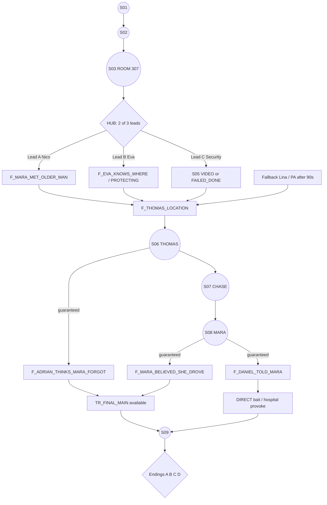

# EP01 — INFORMATION GRAPH

Legend: **R** = required for progression, **F** = enables the final trap, **D** = feeds Ending D, **O** = optional or flavour.
Every R and F fact has ≥ 2 independent sources, or a guaranteed source that cannot be missed.

## 1. Fact table

| Fact | Tag | Meaning | Sources (✔ = guaranteed) | Enables |
|---|---|---|---|---|
| F_WATCH_PAWNED | O | Hale pawned the watch to Jules | S1: Jules break, under-counter drawer, OBSERVE_ONLY auto ✔ | S1 resolution lines |
| F_OLD_ACCIDENT | O | there was an old car accident | S2 deep line; hub "show pocket"; S6 Thomas ✔ | early chips «Авария?» to Eva/Nico |
| F_ADRIAN_EXPECTS_CONTACT | O | Adrian expects Mara to contact someone | S2 bluff grab | T_ADRIAN_FEARS_WHAT_SHE_HAS |
| F_MARA_LEFT_ALIVE | O | Mara left 307 on her own | Lina; Video 23:05/23:40; Nico «она была спокойна» | chip «Её никто не похищал» (Adrian report) |
| F_SECURITY_IN_307 | O | security entered 307 | Lina; 307 search traces (thread); Video 01:10 | PROVOKE vs Daniel (S03 exit / hub) |
| F_SERVICE_STAIR | O | Mara asked about the service stair | Lina; TV map; hub exploration (door is visible anyway) | — |
| F_EVA_ROOM_308 | O | Eva is in 308 | 308 entry (lighter, luggage tag «E. Marsh»); Video 23:40 | the evidence (non-bluff) route to Eva CAUGHT |
| F_MARA_MET_OLDER_MAN | R* | Mara met an older man | Nico; Video 00:20; Eva call (implies) | Thomas stop chip «Ты был водителем Вейлов» (*alt: silence works) |
| F_MARA_ASKED_CAMERAS | O | Mara asked where the cameras are | Nico | — |
| F_DANIEL_ASKING | O | Daniel asked about Mara | Nico; Pavel (if escorted) | T_DANIEL_HIDES_SOMETHING |
| F_EVA_KNOWS_WHERE | R(lead) | Eva knows Mara's location | TR_EVA_615 slip; 308 evidence confrontation; tail detected + honesty | Lead B DONE |
| F_EVA_PROTECTING_MARA | O | Eva protects Mara | burner call overheard; phone 307 text | Lead B DONE (alt) |
| F_THOMAS_NAME | O | the man is Thomas | Eva call; phone 307 text («Т.»); Thomas himself ✔ | chip «Томас.» to stop him (+1 trust) |
| **F_THOMAS_LOCATION** | **R** | Thomas waits at the loading dock | Video 00:31; Nico (Volvo); Eva call; Eva confrontation; phone 307 text; FB Lina ✔; FB PA ✔ | Scene 06 trigger |
| F_DANIEL_SEARCHED_307 | O→F+ | Daniel searched 307 | Video 01:10 (+photo item); thread T_SOMEONE_SEARCHED_307 + Daniel screwdriver tell (inference only, not a fact) | PHOTO bait in the finale; Adrian doubt |
| F_ADRIAN_DANIEL_COORDINATE | O | Adrian and Daniel coordinate the search | Adrian lobby call overheard | — |
| F_DEADLINE_MORNING | O | Mara will go public in the morning | Daniel/Brody overheard; Mara S08 ✔ | — |
| F_THOMAS_TOOK_BLAME | R | Thomas served time for the accident | Thomas S06 ✔ | — |
| F_ADRIAN_WAS_DRIVING | R | Adrian drove | Thomas S06 ✔ (claim); Mara clip S08 ✔ (confirmed) | — |
| F_THOMAS_PAID_SON | O | Adrian's money saved Thomas's son | Thomas S06 (READ photo); Thomas S08 (if missed, one line) | Ending B weight |
| F_THOMAS_CONSENTED | O | Thomas agreed voluntarily | same | — |
| F_RECORDING_EXISTS | R | there is a dashcam recording | Thomas S06 ✔; Adrian overheard («карта»); Adrian pocket frame; pursuers' demand S07 ✔ | — |
| **F_ADRIAN_THINKS_MARA_FORGOT** | **F** | Adrian believes Mara remembers nothing | Thomas S06 ✔ (guaranteed line 6); S2 deep line; Adrian lobby call | TR_FINAL_MAIN bait |
| **F_MARA_BELIEVED_SHE_DROVE** | **F** | Mara believed she was driving | Mara S08 ✔ | TR_FINAL_MAIN bait |
| **F_DANIEL_TOLD_MARA** | **F** | Daniel told her that | Mara S08 ✔ | DIRECT bait, PROVOKE «больница» |
| F_ADRIAN_NEVER_ASKED | F+ | Adrian never asked anyone to make her feel guilty | Thomas S08 ✔ | T_TWO_STORIES, Thomas finale support line |
| F_MARA_WILL_PUBLISH | R | Mara will publish at 08:00 | Mara S08 ✔ | finale stakes, Ending A |
| F_DANIEL_CONFESSED | — | Daniel's admission | S09 | ending text variants |
| F_NICO_RECOMMENDED | O | Nico recommended the hero | Nico warmth 2 | flavour |

**Structural guarantee:** all three F facts (`F_ADRIAN_THINKS_MARA_FORGOT`, `F_MARA_BELIEVED_SHE_DROVE`, `F_DANIEL_TOLD_MARA`) are granted by *guaranteed* lines in mandatory scenes (S06, S08). The final trap therefore **cannot be blocked** by missing optional content. Optional content makes the trap *stronger* (photo, Adrian doubt, fear hits, Mara trust, lead knowledge).

## 2. Dependency graph



Hub gate in pseudo-code:

```
can_start_S06 = leads_completed() >= 2 and has(F_THOMAS_LOCATION)
```

## 3. Observations → threads (hypotheses)

Threads are *player-side beliefs*. They unlock chips but never gate progress.

| Thread | Offered when | True? | Chips it unlocks | If acted on while wrong |
|---|---|---|---|---|
| T_WATCH_NOT_STOLEN | 2 of {WRIST_TAN, JULES_UNDER, UNPAID_TAB, HALE_LOOKS_SELIN} | ✔ | Jules pawn line, Hale private deal | — |
| T_EX_BOYFRIEND | S2 default | ✘ | «Где Лукас?» (to Eva, Nico) | Eva laughs: «Лукас? Он в Лиссабоне два года.» `eva.suspicion +1`; Nico: «Какой ещё Лукас?» Correction for free: T_EX_BOYFRIEND is struck through. |
| T_ADRIAN_FEARS_WHAT_SHE_HAS | O_S2_POCKET_TOUCH or O_S2_GRAB | ✔ | hub «Покажите карман»; finale «Вы боялись не за неё» | — |
| T_307_STAGED | 2 of staged cues | ✔ | Eva «Красивая постановка»; Lina «Кто попросил тебя не убирать?»; Adrian report «Номер инсценирован» | — |
| T_SHE_LEFT_BY_WINDOW | wet shoe + open window w/o sill/escape obs | ✘ | Adrian report «Она ушла через окно» | Adrian sends Daniel's men to the street (fewer hub patrols: an accidental benefit!). Adrian respect -1 later when he learns otherwise. |
| T_SOMEONE_SEARCHED_307 | 2 of search traces / F_SECURITY_IN_307 | ✔ | Daniel PROVOKE (zip line) | — |
| T_EVA_KNOWS | O_EVA_POCKET + (F_EVA_ROOM_308 or eva lies twice) | ✔ | Eva PRESS «Где она?» (CALLED unless CAUGHT) | — |
| T_DANIEL_HIDES_SOMETHING | 2 of {O_DANIEL_*, F_DANIEL_ASKING, Lead C escort} | ✔ | Thomas «Дэниел знает» chip strength +1 | — |
| T_TWO_STORIES | F_MARA_BELIEVED_SHE_DROVE + F_ADRIAN_THINKS_MARA_FORGOT | ✔ (auto-offered, auto-pinned if slot free) | Finale MAIN bait chip visible | — |

## 4. Special dialogue unlocks (fact → chip)

| Chip | Where | Requires |
|---|---|---|
| «Ты был водителем Вейлов.» | Thomas stop | F_MARA_MET_OLDER_MAN or F_THOMAS_NAME |
| «Томас.» | Thomas stop (+1 trust) | F_THOMAS_NAME |
| «Дэниел знает, что ты здесь.» | Thomas stop | met Daniel (always true after S03) |
| «Ты живёшь в 308.» | Eva | F_EVA_ROOM_308 |
| «Он у тебя в кармане, да?» | Adrian (hub report) | T_ADRIAN_FEARS_WHAT_SHE_HAS |
| «Ваш человек обыскивал её номер…» | Adrian (hub or finale) | ITEM_PHOTO_DANIEL_307 |
| «Расскажи им про больницу.» | Daniel (finale) | F_DANIEL_TOLD_MARA |
| MAIN bait | Adrian (finale) | T_TWO_STORIES (i.e. F2 + F1) |
| «Сколько ещё?» | Adrian (finale) | S2 RAISE PRICE |

## 5. Ending D inputs

| Input | Where | Value |
|---|---|---|
| fear_hits.LOSE_MARA | S2 «Если она прячется, то не от бывшего»; hub report «Она прячется от вас»; S2 elevator CALL LIE follow-up «Вы её уже потеряли»; finale pre-trap «Посмотри на неё. Она уже ушла.» | need ≥ 2 |
| adrian.trust ≥ 0 | S1 PRIVATE_DEAL (+1), S2 SILENCE (+1), honest hub report (+1); CALL LIE (-1), pocket demand (-1), WRONG finale bait (-1) | — |
| Daniel resolved | finale | confessed or escaped |

There are **4 sources** of fear hits, at least 2 of which are in mandatory scenes (S2, finale pre-trap), so Ending D is reachable without the optional hub report.

## 6. Fragility audit

| Potential break | Mitigation |
|---|---|
| Player never finds Thomas's location | 6 sources + 2 fallbacks (Lina, PA). |
| Player completes only 1 lead and wanders | After 4 min in the hub with 1 lead: Nico texts «Зайди. Есть кое-что.» (Lead A becomes easy). After 6 min: Eva comes down to the lobby and is visible (Lead B is easy to start). |
| Player makes the security route impossible (caught twice) | It becomes FAILED_DONE and counts. |
| Eva hostile | The tail still works; the phone 307 text; Lead A + C still give 2 leads. |
| Player skips 307 entirely | The Daniel encounter fires in the hallway anyway; the hub opens. |
| Player misses Thomas's personal story | Ending B still available; Thomas states one line about his son in S08. |
| Player doesn't place the card or recorder in the finale | Defaults: card in the hero's pocket, no recording. Endings still reachable. |
| Player doesn't invite Thomas | Ending B unavailable (warned once). A, C, D still available. |
| Player doesn't invite Daniel | «Начать» won't start without Adrian, Mara and Daniel. Mara says: «Без Дэниела это бессмысленно.» |
| Player uses the WRONG bait | Adrian is offended; MAIN and DIRECT remain available. |
| Daniel escapes | Card recovered (dropped), Mara's backup copy; endings still available. |
