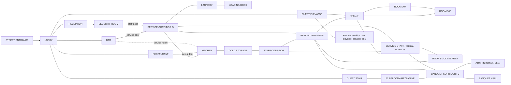

# EP01 — HOTEL LEVEL LAYOUT ("Hotel Meridian")

## 1. Principles

- **One hotel, one Godot world scene** (`scenes/ep01/hotel_world.tscn`). All blocks stay loaded: the graybox geometry is cheap, and keeping everything loaded avoids streaming bugs. Blocks are placed far apart in world space, so the floors don't need to be physically stacked.
- **Transitions** between blocks happen through doors, elevator doors and stairwell doors. The engine performs a teleport covered by a 0.25 s fade or a "door wipe" (a foreground door panel crosses the camera). Pursuers carry across transitions (see ACTION_SEQUENCE).
- **Movement model:** `CharacterBody3D` moving in camera-relative XZ with collision. Corridors are narrow walkable strips; rooms are wider. "Lanes" are not code: they are authored strips of floor separated by furniture with gaps (foreground lane, mid lane, background lane).
- **Camera:** each sub-area has a `CameraZone` (an Area3D) that references a `CameraRig` (position, look target, follow axis, damping, FOV). Zones blend over 0.6 s. Input direction is locked to the previous rig until the stick or keys are released (the standard 2.5D trick against direction flips).
- Every space is reused at least twice (scene count per zone is listed below).

## 2. Block map



## 3. Zones

Dimensions are graybox metres (W = along screen X, D = depth). "Mode" is CORRIDOR (narrow strip, side camera) or ROOM (wide, three-quarter camera).

| Zone | W×D | Mode | Lanes / layers | Used in scenes | Notes |
|---|---|---|---|---|---|
| STREET | 30×6 | CORRIDOR | FG: parked cars (silhouettes); MID: sidewalk; BG: hotel facade, revolving door | Epilogue (and the optional title shot) | Rain and puddle reflections. |
| LOBBY | 28×14 | ROOM | FG: pillars, palm planter (cover), lounge armchairs; MID: open floor, fountain; BG: reception desk, elevator bank, guest stair | S02, S04, S09 approach, Epilogue | The keypad-peek spot is behind the planter. Adrian's phone armchair is next to pillar P2 (overhear zone). |
| BAR | 16×10 | ROOM | FG: stools; MID: counter (walk-behind gap at the right end); BG: booths by the rain windows | S01, S02, S04 (Lead A) | House phone on the wall by the arch. Service door to SCORR at the back right. |
| RECEPTION BACK | 5×4 | ROOM | — | S04 | Connects to the security keypad door. Cart-disguise route ends here. |
| SECURITY ROOM | 6×4 | ROOM | Monitor wall BG, desk MID, chair | S05 | Two doors: keypad (reception) and staff keycard (SCORR). |
| GUEST ELEVATOR | 2.5×2 | ROOM (locked rig) | — | S02 | Fake motion; floor indicator. |
| HALL_3F | 34×4 | CORRIDOR | FG: trays, ice machine alcove (hide); MID: carpet; BG: doors 301–316 | S03, S04 | Elevator at the left end, service stair door at the right end, freight elevator midway in a staff alcove. |
| ROOM_307 | 7×6 | ROOM | Desk/glasses left, bed BG, window BG-right, bathroom right | S03 | Connecting door to 308 on the left wall. |
| ROOM_308 | 6×6 | ROOM | — | S03 (optional) | Mirror of 307: Eva's clutter, lighter, two coffees. |
| SERVICE_STAIR | 6 wide × 4 floors | VERTICAL SIDE-SECTION | Landings G, 1 (mezz), 2, 3, ROOF; railings are crouch cover | S04 (tail), S07 (chase) | One scene for all floors: the camera follows vertically. A dead camera sits on landing 2. |
| ROOF_SMOKING | 18×6 | CORRIDOR | FG: HVAC units (cover); MID: deck; BG: parapet, skyline | S04 (Eva) | The heaviest rain. |
| MEZZANINE (F2 balcony) | 12×3 | CORRIDOR | Looks down into LOBBY | S04 (overhear Adrian) | Connects to BANQUET_CORRIDOR. |
| SERVICE_CORRIDOR_G | 30×3.5 | CORRIDOR | FG: linen carts, crates; BG: doors to bar, security, kitchen, laundry, freight, stair | S04, S05 exit, S06 approach, S07 | The spine of back-of-house. |
| LAUNDRY | 14×8 | ROOM | Rows of machines (FG/BG), folding tables (vault), hanging sheets (break LOS), cart lanes | S06 approach, S07 | The key hook for the staff door is by the entrance. |
| LOADING_DOCK | 26×10 | ROOM (wide side) | FG: raised dock edge (drop down), MID: yard and Volvo, BG: rolling gate | S06, S07 start | Rain and sodium light. |
| KITCHEN | 20×9 | ROOM | Two prep islands (vault/slide), hood with fire-suppression pull, pass to the restaurant (swing door), hatch to the bar | S07, S09 (ending C burner) | Pots and pans make noise objects. |
| COLD_STORAGE | 8×6 + walk-in freezer 3×3 | ROOM | Shelving rows (break LOS) | S07 (lock-in trap, interrogation fail-forward) | The freezer door latches from outside. |
| STAFF_CORRIDOR | 24×3 | CORRIDOR | Lockers FG, breaker panel, radio on a bench | S07 | Lights-out tool. A dropped radio (bluff tool) appears here. |
| FREIGHT_ELEVATOR | 3×3 | ROOM (locked rig) | — | S07 (route B), S08 (Thomas arrives) | It stops at G, 2, 3 and ROOF. It can be sent empty as a decoy. |
| BANQUET_CORRIDOR_F2 | 26×4 | CORRIDOR | FG: stacked chairs and gala leftovers; BG: Banquet Hall doors, Orchid Room door | S07 end, S08 exit | Convergence point of the chase routes. |
| BANQUET_HALL | 24×14 | ROOM | Round tables, dropped cloths | S07 (route B variant: table vaults, cloth hide) | Reuses restaurant furniture. |
| ORCHID_ROOM | 9×7 | ROOM | Stacked chairs FG, round table MID, windows BG | S08 | — |
| RESTAURANT | 18×10 | ROOM | Four-top by the window centre; bar shelf left; kitchen swing door back-left; main doors right; terrace door back-right | S09 | Light panel by the main doors. |

## 4. Camera orientation changes

| Location | Change | Why |
|---|---|---|
| BAR → LOBBY arch | Three-quarter → side tracking | Walk-and-talk reads best side-on. |
| LOBBY → elevator | Cut to a locked cabin three-quarter | Confinement. |
| HALL_3F → 307 | Side → high-corner three-quarter | Investigation needs depth. |
| 307 bathroom | Dedicated rig facing the mirror | Message reveal shot. |
| SCORR → SERVICE_STAIR | Side → vertical section | Signature shot of tailing and chase. |
| LOADING_DOCK | Very wide side, low height | Western-like standoff with Thomas, then the chase start. |
| KITCHEN / LAUNDRY | Three-quarter from above (pseudo-isometric) | Routes are readable during the chase. |
| RESTAURANT staging → live | Wide overhead → table orbit rig | Planning vs. reading faces. |

## 5. NPC paths (authored waypoints)

| NPC | Path (hub unless noted) |
|---|---|
| Pavel | SECURITY chair → RECEPTION → LOBBY loop (planter, fountain, elevator) → back. ~100 s cycle. |
| Daniel | LOBBY (elevator bank) → HALL_3F (307 door, pause) → SERVICE_STAIR → SCORR → SECURITY (talks to Pavel) → LOBBY. ~3 min cycle. The first visit is the scripted S03 encounter. |
| Adrian | LOBBY armchair (phone call, minutes 2–4) → elevator → F5 (off-screen). Returns to LOBBY when the hero texts or at the S04 report. |
| Nico | Behind-bar circuit (taps → till → glass rack) → guest tables → SCORR service door (smoke, 60 s, every ~3 min). |
| Eva | ROOF (smoking) → (approached) SERVICE_STAIR down → landing 1 (burner call) → SCORR → LAUNDRY door (checks for Thomas) → back up the guest stair. |
| Lina | HALL_3F cart route (rooms 310–316) → freight alcove → SCORR (linen room). |
| Brody | LOADING_DOCK van (out of hub sight) → SCORR once (minute ~5, with Daniel at the roof door overhear). |
| Thomas | LAUNDRY door ↔ Volvo (S06). Also appears in S04 at minute ~6, smoking under the dock canopy (visible from the laundry window). |

## 6. Chase shortcuts (summary; full in ACTION_SEQUENCE)

- **LAUNDRY:** a slide under the folding table (hero only, since pursuers vault slower) and the hanging-sheet curtain (break LOS).
- **KITCHEN:** a vault over the prep island, the swing door to the restaurant (route C), and the fire-suppression pull.
- **COLD_STORAGE:** the freezer lock-in.
- **STAFF_CORRIDOR:** the breaker (lights out) and lockers (hide, once).
- **FREIGHT_ELEVATOR:** ride or send empty as a decoy.
- **SERVICE_STAIR:** a drop between landings (one-way, the hero takes 0.5 s of stun but gains 6 m).
- **BANQUET_HALL:** a table vault chain and a tablecloth hide.

## 7. Transition / loading points

All transitions are teleports with a 0.25 s cover, and none take longer than 0.5 s.

```
LOBBY ↔ ELEV_A ↔ HALL_3F (elevator doors, cabin scene in between)
HALL_3F ↔ SERVICE_STAIR (door, landing 3)
SERVICE_STAIR ↔ ROOF / BANQUET_CORRIDOR / SCORR / MEZZANINE (doors per landing)
SCORR ↔ LAUNDRY / KITCHEN / BAR / SECURITY / FREIGHT
LAUNDRY ↔ LOADING_DOCK
KITCHEN ↔ COLD_STORAGE ↔ STAFF_CORRIDOR
KITCHEN ↔ RESTAURANT (swing door: seamless, same block)
FREIGHT ↔ (G, F2 banquet, F3 hall, ROOF)
LOBBY ↔ STREET (revolving door)
```

Godot implementation: `Doorway` nodes have `target_doorway: NodePath`. Teleport the player, snap the camera to the target zone's rig, run the fade and play the door SFX. Same-block doors (swing doors, room doors) are physical with no teleport.

## 8. Graybox palette (so art can replace later)

| Element | Graybox |
|---|---|
| Walls/floors | CSGBox3D / MeshInstance BoxMesh. Floor dark grey, walls mid grey, per-zone accent tint on one wall (e.g. bar warm, service blue-green). |
| Doors | Box + `Doorway`/`Door` script. Orange trim = interactive. |
| Cover objects | Brown boxes. |
| Vaultables | Boxes with a yellow top stripe. |
| Interactables | Cyan small meshes (debug outline toggle). |
| Observables | Invisible markers (debug gizmo only). |
| Characters | Capsules with a head sphere, a nose wedge for facing, a coloured band per NPC, and two cylinder "hands" (needed for hand tells). |
| Rain | GPUParticles3D quads plus a window-streak shader on glass planes. |

Art replacement contract: gameplay scripts reference **marker nodes** (`InteractPoint`, `ObservablePoint`, `SeatPoint`, `StagePoint`, `CoverPoint`), never mesh nodes. Final meshes are dropped under `Visual` child nodes.
